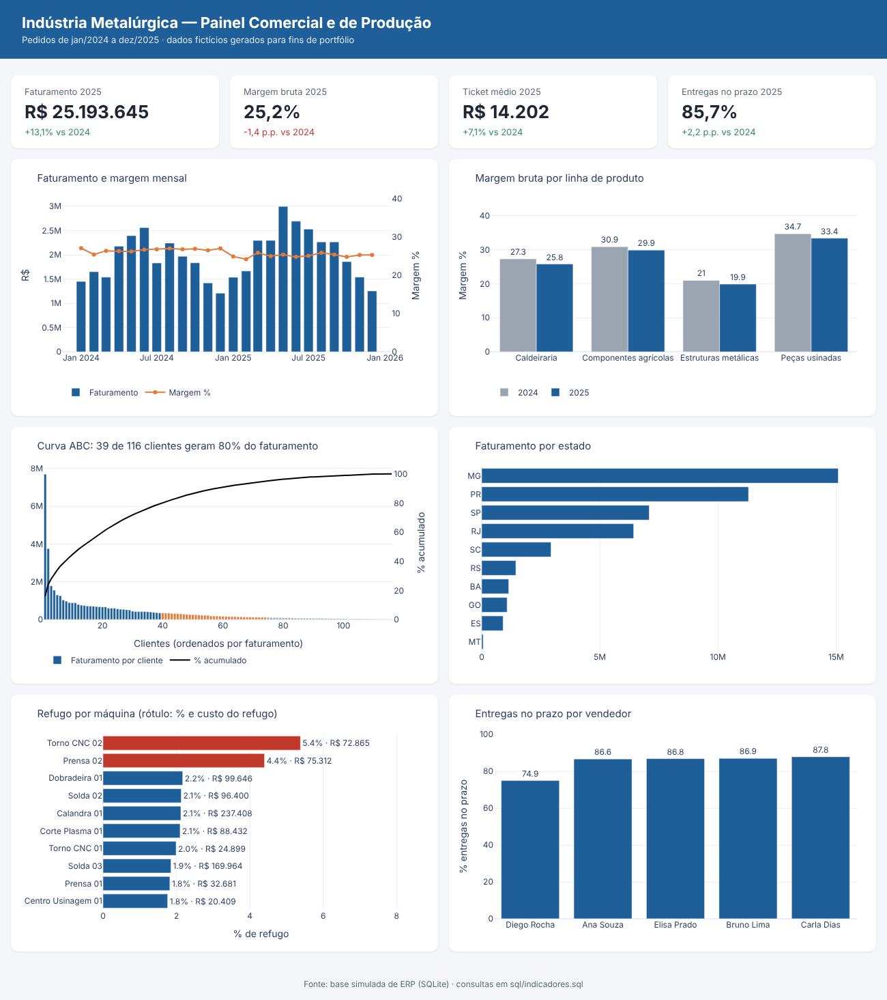

# Painel Comercial e de Produção — Indústria Metalúrgica

Projeto de **Business Intelligence** de ponta a ponta: modelagem de dados no formato de um ERP industrial, indicadores em **SQL** e dashboard interativo (HTML/Plotly, com o modelo pronto para replicar no **Power BI**).



> ⚠️ Os dados são **fictícios**, gerados por script (`src/gerar_dados.py`) com comportamentos realistas: sazonalidade, crescimento, concentração de clientes, atrasos e refugo. Nenhuma informação real de empresa foi usada.

## Pergunta de negócio

Uma indústria metalúrgica quer acompanhar em um só painel:

- Como evoluíram **faturamento e margem** de 2024 para 2025?
- Quais **linhas de produto** perderam margem?
- **Quais clientes** concentram o faturamento (curva ABC)?
- Onde estão os **gargalos de qualidade** na produção (refugo por máquina)?
- As **entregas** estão saindo no prazo? Existe diferença entre vendedores?

## Principais conclusões

| Indicador | 2024 | 2025 |
|---|---|---|
| Faturamento | R$ 22,3 mi | R$ 25,2 mi (**+13,1%**) |
| Margem bruta | 26,6% | 25,2% (**−1,4 p.p.**) |
| Ticket médio | R$ 13.263 | R$ 14.202 |
| Entregas no prazo | 83,5% | 85,7% |

1. **O faturamento cresceu, mas a margem caiu em todas as linhas.** O reajuste de preço (+6%) não acompanhou o aumento de custo (+8%). Recomendação: revisar a tabela de preços, começando por Estruturas metálicas, que já tem a menor margem (≈20%).
2. **Concentração de clientes:** 39 de 116 clientes geram 80% do faturamento e o maior cliente sozinho responde por ~16%. É um risco comercial que vale monitorar.
3. **Duas máquinas concentram o problema de qualidade:** Torno CNC 02 (5,4% de refugo) e Prensa 02 (4,4%) têm mais que o dobro do refugo das demais. Prioridade para manutenção.
4. **Atrasos:** um vendedor tem 74,9% de entregas no prazo, contra ~87% dos demais. A causa provável são prazos prometidos curtos demais, o que pede alinhamento entre comercial e PCP.

## Modelo de dados (esquema estrela)

```
                 dim_calendario
                       │
dim_cliente ── fato_pedido ── fato_item_pedido ── dim_produto
                                    │                  │
                          fato_ordem_producao ─────────┘
```

| Tabela | Conteúdo |
|---|---|
| `dim_produto` | 60 produtos, 4 linhas, preço de tabela, custo, tempo padrão |
| `dim_cliente` | 120 clientes, UF e segmento |
| `dim_calendario` | datas de 2024 e 2025 |
| `fato_pedido` | ~3,4 mil pedidos: vendedor, data prevista e data de entrega |
| `fato_item_pedido` | ~8,6 mil itens: quantidade, preço praticado, custo, desconto |
| `fato_ordem_producao` | ordens de produção: máquina, quantidade, refugo, tempo planejado x real |

## Consultas SQL

Todas em [`sql/indicadores.sql`](sql/indicadores.sql). Técnicas usadas:
- `JOIN` entre fatos e dimensões, agregações
- **CTEs** (`WITH`)
- **Funções de janela**: `LAG` (comparação com o ano anterior), `SUM() OVER` (percentual acumulado da curva ABC), `ROW_NUMBER`
- `CASE WHEN` para classificação ABC e indicador de entrega no prazo

## Como replicar no Power BI

1. **Obter dados → Texto/CSV** e importar os arquivos de `dados/` (separador `;`, decimal `,`).
2. Criar os relacionamentos do diagrama acima (1:N das dimensões para os fatos). Relacionar `dim_calendario[data]` com `fato_pedido[data_pedido]`.
3. Coluna calculada em `fato_item_pedido`:
   ```DAX
   Receita = fato_item_pedido[quantidade] * fato_item_pedido[preco_unitario]
   ```
4. Medidas:
   ```DAX
   Faturamento = SUM ( fato_item_pedido[Receita] )

   Margem R$ = SUMX ( fato_item_pedido,
       fato_item_pedido[quantidade] * ( fato_item_pedido[preco_unitario] - fato_item_pedido[custo_unitario] ) )

   Margem % = DIVIDE ( [Margem R$], [Faturamento] )

   Faturamento Ano Anterior = CALCULATE ( [Faturamento], SAMEPERIODLASTYEAR ( dim_calendario[data] ) )

   Variação vs Ano Anterior % = DIVIDE ( [Faturamento] - [Faturamento Ano Anterior], [Faturamento Ano Anterior] )

   Ticket Médio = DIVIDE ( [Faturamento], DISTINCTCOUNT ( fato_pedido[id_pedido] ) )

   Entregas no Prazo % =
   DIVIDE (
       COUNTROWS ( FILTER ( fato_pedido, fato_pedido[data_entrega] <= fato_pedido[data_prevista_entrega] ) ),
       COUNTROWS ( fato_pedido )
   )

   Refugo % = DIVIDE ( SUM ( fato_ordem_producao[qtd_refugo] ), SUM ( fato_ordem_producao[qtd_planejada] ) )
   ```
5. Visuais sugeridos: cartões (KPIs), gráfico de colunas + linha (faturamento x margem), colunas agrupadas (margem por linha), Pareto (curva ABC), barras (refugo por máquina), segmentações por ano, linha e UF.

## Como executar

```bash
pip install -r requirements.txt
python src/gerar_dados.py   # gera os CSVs e o banco SQLite em dados/
python src/dashboard.py     # roda as consultas SQL e gera dashboard/index.html
```

Para publicar o dashboard online: no GitHub, vá em **Settings → Pages**, escolha a branch `main` e acesse `https://SEU-USUARIO.github.io/NOME-DO-REPOSITORIO/dashboard/`.

## Tecnologias
Python (pandas, NumPy) · SQL (SQLite) · Plotly · Power BI (DAX)
